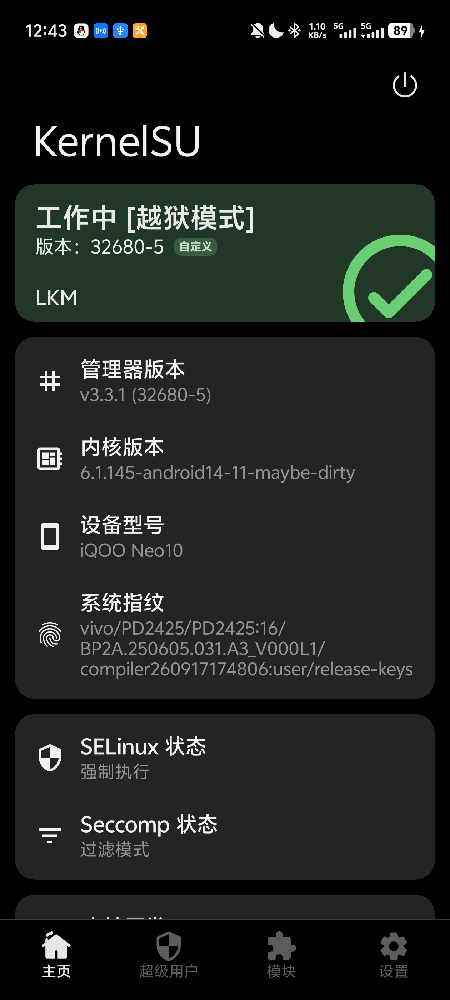
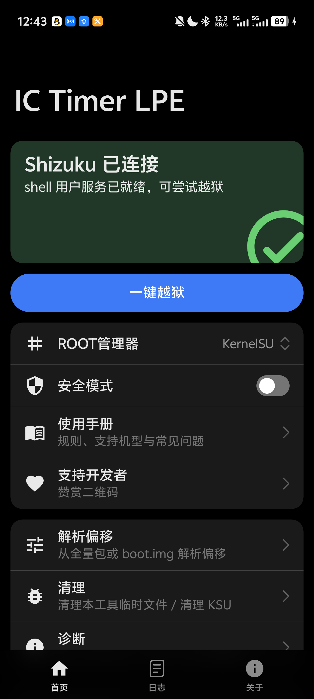

# IC Timer LPE —— iQOO Neo 10 实测通过版（预编译 APK）

> ## ⚠️ 这不是原作者仓库
>
> 本仓库是 **[kzktor/ic-timer-lpe](https://github.com/kzktor/ic-timer-lpe)** 的 **fork / 镜像**，
> 只做两件事：**提供我编译好的 APK 供直接下载**，以及**记录在一台 iQOO Neo 10 上的成功实测**。
>
> **代码、思路、偏移表全部来自原作者，本人没有任何原创贡献。**
>
> - 原作者：**kzktor** —— <https://github.com/kzktor/ic-timer-lpe>
> - 作者酷安：**@散花神木**
> - 许可证：**GNU GPL-3.0**（见 [`LICENSE`](LICENSE)、[`NOTICE`](NOTICE)）
>
> 一切荣誉归原作者。若本仓库与上游有任何出入，**以上游为准**。
> 如果这个工具对你有用，请去上游点 Star，而不是这里。

---

## 这是什么

`IC Timer LPE` 是针对 **CVE-2026-98260**（POSIX CPU timer 释放后使用，UAF）的提权工具，
适用于 **vivo / iQOO 6.1.145 内核**机型：从 shell 域拿到 uid 0，并可把 root 交给
**KernelSU** 系列管理器（late-load 管理器自带的 `ksud` / 内核模块）。

它是一个 **Shizuku 用户服务** APK：root 动作跑在 Shizuku 提供的 shell 身份下，不依赖
已 root 环境 bootstrap。

## 实测记录：iQOO Neo 10（成功 ✅)

| 项目 | 值 |
| --- | --- |
| 机型 | iQOO Neo 10（V2425A / PD2425） |
| 内核 | `6.1.145-android14-11-maybe-dirty` |
| 系统指纹 | `vivo/PD2425/PD2425:16/BP2A.250605.031.A3_V000L1/compiler260917174806:user/release-keys` |
| 提权结果 | 成功，shell 域 uid 0 |
| ROOT 管理器 | KernelSU **v3.3.1 (32680-5)**，`工作中 [越狱模式]`，LKM 模式 |
| SELinux | 强制（Enforcing），未关闭 |
| Seccomp | 过滤模式 |
| 测试日期 | 2026-11-08 |

<table>
<tr>
<td width="50%"></td>
<td width="50%"></td>
</tr>
<tr>
<td align="center">KernelSU 已接管，LKM 模式工作正常</td>
<td align="center">Shizuku 已连接，可一键越狱</td>
</tr>
</table>

也就是说：在上述 build 上**不需要**从 `boot.img` 解析偏移，`PD2425 / V2425`
的内置偏移表直接命中。

## 下载

**推荐从 [Releases](../../releases) 下载**，那里是正式发布的附件：

- [`apk/ic-timer-lpe-0.21.4.apk`](apk/ic-timer-lpe-0.21.4.apk) —— 仓库内也存了一份，方便直连

| 项 | 值 |
| --- | --- |
| 版本 | 0.21.4（versionCode 214） |
| 包名 | `dev.ic.timerlpe` |
| 大小 | 5,525,228 字节（约 5.27 MiB） |
| SHA-256 | `365deb9c7ac6a7487c1033cc7445cb1447d5428820421aef80d27e91e5ed00ec` |
| minSdk / targetSdk | 33 / 37 |
| ABI | `arm64-v8a` 仅此一个 |

校验：

```sh
sha256sum ic-timer-lpe-0.21.4.apk
# Windows: certutil -hashfile ic-timer-lpe-0.21.4.apk SHA256
```

> **签名说明：** 这个 APK 是我用**自己生成的证书**签的（`CN=ic-timer-lpe`，V2 签名），
> **不是**上游作者的原签名。因此：
> - 无法覆盖安装包名相同的其他构建，需要先卸载旧版本；
> - 与上游/他人的构建不共享 `sharedUserId` 之外的任何信任关系，属正常现象。

## 使用步骤

1. **重启手机**。每次完整运行前都要重启，上一次失败残留的 zombie 不能 `kill -9`。
2. 用 **adb / 无线调试** 启动 Shizuku（**不能用 root 启动**）。App 内「Shizuku 已连接」即就绪。
3. 打开 `IC Timer LPE`，在 **ROOT 管理器** 下拉里选 **KernelSU**（只想验证提权就留空，走 shell 路径）。
4. 点 **一键越狱**，按钮上会显示阶段（如 `7/12 零写 vr.ko`）。
5. 结束后回到 KernelSU 确认「工作中」。

更详细的规则、支持机型与常见问题，请用 App 内 **使用手册** 入口，或直接看上游 README。

## 已知限制

- 仅适用于 **6.1.145 内核**的 vivo / iQOO 机型；其他内核不要尝试。
- 仅 `arm64-v8a`，`minSdk 33`。
- 内置偏移表未覆盖的 build，需要先用 App 的 **解析偏移**（从 `boot.img` / 全量 OTA 提取）
  生成 `/data/local/tmp/ic-syms.txt`。
- 未实测的 build 失败时通常表现为 `fork/exec errno=12`（ENOMEM），一般不会 panic，
  但**不保证**。

## 我怎么编译的

代码零改动，产物即上游 `main` 分支（`apk-gradle/`）的 `assembleRelease`：

```sh
cd apk-gradle
./gradlew :app:assembleRelease -Pic.keystore=<你的 keystore>
```

- JDK 21.0.2 / Gradle 9.7.1 / AGP 9.4.1 / Kotlin 2.4.20
- compileSdk 37，build-tools 37.0.0
- `assets/ic-timer` 直接使用仓库内的预编译二进制（未重编 native core）
- 签名用自签名 keystore（alias `ic`）

详见 [`BUILD.md`](BUILD.md)。

## 免责声明（照抄上游，请务必读）

本工具仅供 **安全研究与自有设备测试** 使用。使用前请确认你对目标设备拥有合法授权；
严禁用于未授权设备或任何非法用途。

- 本软件按“现状”提供，不提供任何明示或暗示的担保；
- 提权过程涉及内核写原语，可能导致设备重启、数据损坏甚至变砖；运行前请自行备份，
  并确认具备恢复手段（原厂 `boot.img` / 完整 OTA）；
- 使用本工具产生的一切后果由使用者自行承担，原作者、贡献者与本镜像仓库均不承担
  任何直接或间接责任；
- 请遵守当地法律法规以及设备厂商的用户协议。

**仅供学习使用，请下载后 24 小时内删除。如设备出现任何问题，概不负责。**

## 许可证

本仓库内容（含预编译 APK）按 **GNU GPL-3.0** 分发，与上游一致。
对应源码见本仓库（fork 自上游）及 <https://github.com/kzktor/ic-timer-lpe>。
